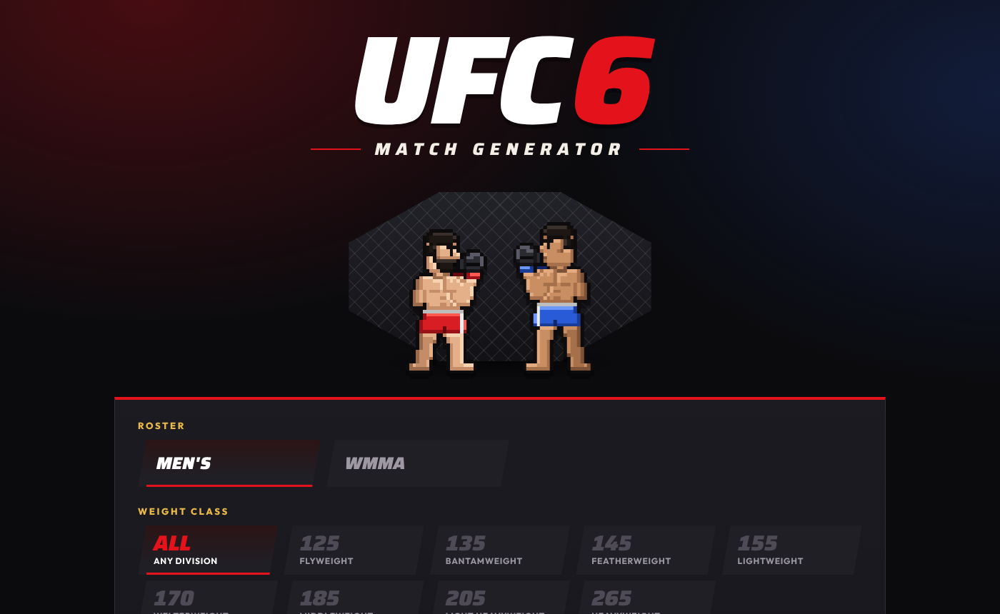
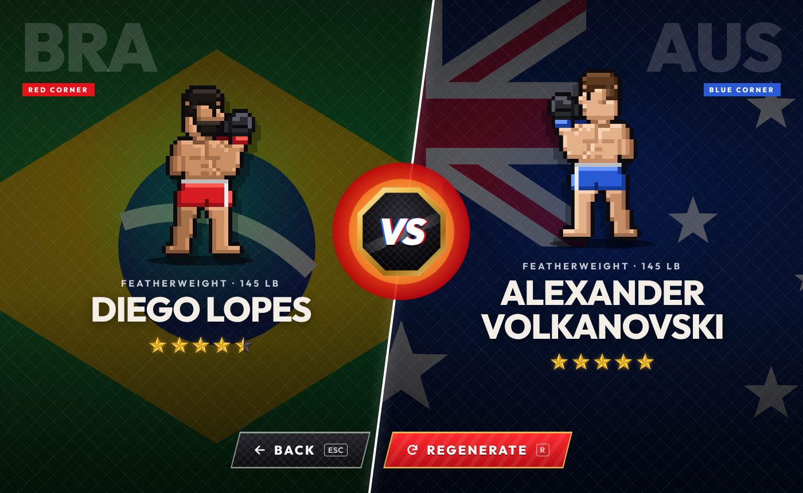

# UFC 6 Match Generator

A random fight picker for EA Sports UFC 6. Choose a roster, a weight class and a star range, and it books a red corner vs blue corner matchup between two fighters from the same division.

**Test it out!** https://daiyannawar.github.io/ufc6-match-generator/




## Features

- **193 fighters** across men's (flyweight 125 to heavyweight 265) and WMMA (strawweight 115 to bantamweight 135), including legends like Georges St-Pierre, Fedor Emelianenko and Ronda Rousey
- **Weight class** filter, or "Any division" to pick one at random
- **Star rating range** with MIN and MAX pickers, in half-star steps
- **Matchup screen** with each fighter's country flag, 3-letter country code, an animated 8-bit fighter, the division and their star rating
- Never repeats the same matchup twice in a row
- Keyboard shortcuts: `Enter` generates a fight, `R` regenerates, `Esc` goes back
- Remembers your last filters in the browser
- Works on phones; the matchup screen stacks top and bottom on narrow screens

## Run it locally

It's one HTML file with no build step and no dependencies. Either open `index.html` in a browser, or serve the folder:

```sh
python3 -m http.server 8000
# then open http://localhost:8000
```

An internet connection is only needed for the Google Fonts (Outfit and Saira). Without it, the page falls back to system fonts.

## Editing the roster

Fighters live in the `ROSTER_TEXT` block near the top of the `<script>` in `index.html`. There's one fighter per line:

```
gender | division | name | country | stars | skin | hair | hair colour | beard
M|LW|Charles Oliveira|BRA|4.5|2|s|k|0
```

| Field | Values |
| --- | --- |
| gender | `M` men, `W` women |
| division | Men: `FLY` `BW` `FW` `LW` `WW` `MW` `LHW` `HW`. Women: `SW` `FLY` `BW` |
| country | 3-letter code with a flag in `FLAGS` (e.g. `USA`, `BRA`, `RUS`, `ENG`) |
| stars | `0.5` to `5` in half steps |
| skin | `0` (lightest) to `4` (darkest) |
| hair | `b` bald, `s` short, `c` curly, `l` long, `p` ponytail |
| hair colour | `k` black, `n` brown, `y` blond, `r` red, `g` grey |
| beard | `1` or `0` |

A fighter can appear in more than one division (Jon Jones and Alex Pereira do). To add a new country, add an entry to `FLAGS`: a name, a glow colour and a small SVG drawn in a 90×60 box.

## Where the roster comes from

EA hasn't published one full roster list, so the roster combines:

- [EA's UFC 6 ratings hub](https://www.ea.com/games/ufc/ufc-6/ufc-6-ratings-hub) division pages
- Launch roster lists from [PixelNitro](https://pixelnitro.com/ea-sports-ufc-6-roster-all-confirmed-fighters-new-additions-and-legends-at-launch/) and [Heavy](https://heavy.com/sports/ufc/ea-sports-ufc-6-fighter-roster/)
- Post-launch additions such as Tank Abbott, Uros Medic, Kevin Vallejos, Josh Hokit, Kyoji Horiguchi, Quillan Salkilld, Lone'er Kavanagh, Valter Walker and Aaron Pico ([Forbes](https://www.forbes.com/sites/brianmazique/2026/08/05/ea-ufc-6-update-ufc-330-content-2-new-fighters-and-gameplay-changes/), [Heavy](https://heavy.com/sports/ufc/new-fighters-ea-sports-ufc-6/))

A few current UFC fighters who didn't show up in those sources (for example Joshua Van, Song Yadong and Paddy Pimblett) are kept in as well.

**Star ratings:** only the twelve 5-star fighters are confirmed by EA ([Bleacher Report](https://bleacherreport.com/articles/25430220-ufc-6-reveals-5-star-fighter-ratings-jon-jones-conor-mcgregor-more-ahead-release-date)): Jon Jones, Conor McGregor, Amanda Nunes, Israel Adesanya, Alex Pereira, Alexander Volkanovski, Max Holloway, Ilia Topuria, Zhang Weili, Valentina Shevchenko, Islam Makhachev and Alexandre Pantoja. Every other rating is an estimate. If you know a fighter's real in-game rating, a pull request is welcome.

## Notes

The flags and fighter sprites are drawn in code, so the page loads no images.

Fan-made project. Not affiliated with or endorsed by EA Sports or the UFC.

## License

[MIT](LICENSE)
